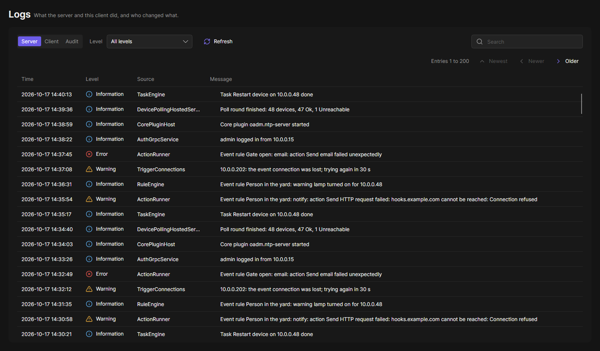

## Logs

Logs roll daily or at 20 MB (server) / 10 MB (client). OADM keeps the last 14 days and at most 30 files.

| | Server log (`oadm-server-<date>.log`) | If the server fails before its log starts |
|---|---|---|
| Windows | `%ProgramData%\OADM\logs\` | Event Viewer, Windows Logs > Application (source ".NET Runtime") and System (Service Control Manager) |
| Linux | `/var/lib/oadm/logs/` | `journalctl -u oadm-server` |
| macOS | `/Library/Application Support/OADM/logs/` | `/Library/Logs/OADM/oadm-server.err.log` |

The client writes `client-<date>.log` to `%LOCALAPPDATA%\Oadm\logs`, `~/.local/share/Oadm/logs` or
`~/Library/Application Support/Oadm/logs`. Client error messages name the log file.

The **Logs** page shows them without opening a file:

- **Server**: the server's log, 200 entries a page, newest first, with **Newer** and **Older**. Filter by level and
  search; the tooltip of a message shows the whole entry. Every failed event rule action is here with its reason, also
  when the event log was already cleared. Administrators see it; other roles need **See the server log** (Permissions page,
  roles).
- **Client**: what this client did since it started, the same way.
- **Audit** (administrators): who did what on the server.

## Common problems

**The client cannot connect ("Cannot reach the server").**
Check that the service runs (`OADM Server` in Windows services, `systemctl status oadm-server`) and that TCP 5080 is
open on the server's firewall, then click **Try again**. Port 5081 is for site nodes, not for the client.

**"The server certificate changed".**
The server got a new certificate, for example after a reinstall with a new data folder. If you expect that, click
**Forget server** in the box below the server field and trust the server again.

**Devices show Credentials required.**
The device rejects the stored password. Right-click > **Log in** and enter the right one for all of them.

**"The device accepts only Basic login over HTTP".**
The device has HTTPS turned off and accepts only Basic login on HTTP. OADM does not send passwords unencrypted unless you
allow it, so the Status column shows **Basic login only** even with the right password. Either:

- turn on HTTPS on the device (recommended), or allow Digest login for HTTP there, or
- turn on **Allow Basic login over HTTP** in [Settings](../settings/) > Security. OADM then logs in to such devices with
  Basic over HTTP, for status checks, tasks, Log in, Web View and live view. Devices that offer Digest or HTTPS keep
  using them.

On the device, the login method is a setting of its web interface (HTTP authentication).

**Devices show Certificate changed.**
The device presents another HTTPS certificate than when it was added. OADM sends nothing to it. Find out why, then
remove the device and add it again.

**NTP or DHCP server: port in use.**
Another program holds the port. The page names it when it can, for example the Windows Time service. See
[NTP server](../../tools/ntp-server/) and [DHCP server](../../tools/dhcp-server/).

**A task failed with "Nothing was changed".**
The device does not support it, for example its AXIS OS is too old. The task's **Details** show the step and the reason.

Still stuck? Create a support report (administrators: **Settings** > **Support** > **Create support report**) and attach it to your post in
the [Support Forum](https://support.oadm.app/) or to an [issue](https://github.com/Cacsjep/oadm/issues/new/choose).
