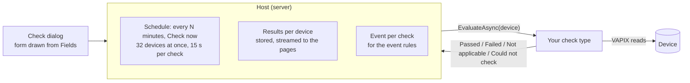

The Compliance page shows which devices need attention. Users add **checks**: a kind of check with its settings, the
devices it is for, Problem or Warning, and how often it runs. The kinds come from the host (Reachable, Login works,
Certificate, Firmware) and from plugins (Application running, Matches configuration file, SD card). Your plugin can add
its own kind with one class. You write how one device is checked. The host does the rest:



## Write a check type

A check type implements `IComplianceCheckType` (`Oadm.Sdk.Compliance`) in a plugin's `*.Server.dll`. Two ways to register
it:

- **Standalone**: a public class with a parameterless constructor. The loader finds it like a task plugin or an action.
- **From a core plugin**: the core plugin implements `IComplianceSource` and returns its types from
  `ComplianceCheckTypes`. Use this when the check needs the core plugin's state.

No client part is needed: the check dialog draws the settings form from `Fields`.

```csharp
using System.Text.Json;

using Oadm.Sdk.Actions;
using Oadm.Sdk.Compliance;

namespace Acme.Plugins.Parking;

/// <summary>Compliance check "Parking app running": the parking application runs and counts at least N lanes.</summary>
public sealed class ParkingAppCheck : IComplianceCheckType
{
    public string Id => "acme.parking.running";              // unique among check types
    public string DisplayName => "Parking app running";      // the "Kind of check" select
    public string? IconKey => "app";
    public string Group => "Applications";                   // the group in the select
    public string? Description => "The parking application runs and counts the lanes you set.";

    public IReadOnlyList<ActionField> Fields =>
    [
        ActionField.Number("lanes", "At least lanes", 1, 16, 1),
    ];

    public string Describe(JsonElement settings) =>              // one line for the page
        "Parking app running, at least " + settings.GetProperty("lanes").GetInt32() + " lanes";

    public async Task<ComplianceResult> EvaluateAsync(IComplianceContext ctx, ComplianceInvocation check, CancellationToken ct)
    {
        // Every check of this run that asks for the same key gets the same answer: one request per device.
        var status = await ctx.Reads.GetOrAddAsync("acme.parking:status", t => ParkingApi.ReadStatusAsync(ctx.Vapix!, t), ct);
        if (!status.Running)
        {
            return ComplianceResult.Failed("The parking app is stopped");
        }

        var lanes = check.GetInt("lanes") ?? 1;
        return status.Lanes >= lanes
            ? ComplianceResult.Passed($"{status.Lanes} lanes")
            : ComplianceResult.Failed($"{status.Lanes} lanes, needs {lanes}");
    }
}
```

### Results

| Result | Meaning | Shown as |
|---|---|---|
| `ComplianceResult.Passed(detail)` | The device meets the check. | Green check; "OK" in the device list |
| `ComplianceResult.Failed(detail)` | The device does not meet it. | Red (Problem) or amber (Warning): the user sets the severity per check; `DefaultSeverity` is the start value |
| `ComplianceResult.NotApplicable(reason)` | The check cannot mean anything here ("HTTPS is off"). | Neutral |
| `ComplianceResult.CouldNotCheck(reason)` | A read failed. Throwing does the same with the exception's message. | Neutral, counted as "not checked" |

Keep the detail short. The first line shows next to the icon on the Compliance page; more lines show joined with "; "
there and one per line in the tooltip ("2 settings differ" then the differences). The host keeps at most 1,000 characters.

### Rules

- **Read only.** A check never changes a device. Use GETs and list calls.
- **The host decides who is contacted.** Devices that are Unreachable, need credentials, have no password, have a
  changed certificate or whose site is offline never reach `EvaluateAsync`; they show "Not checked" with the reason.
- **Sites.** `IComplianceCheckType.SiteSupport` (null = the package's `siteSupport`) says whether the type checks devices
  at a site; with `none` they are Not checked ("Not available for devices at a site"). See [Sites](../sites/).
- **Time.** 15 s per check and device (`ct` is cancelled); a timeout is "Timeout after 15 s".
- **Shared reads.** `ctx.Reads.GetOrAddAsync(key, read, ct)` runs `read` once per device and run for every check that uses
  the key. Name the key after your plugin ("acme.parking:status"). The host's own plugins share `oadm.acap:list`
  (applications) and `oadm.edge-storage:disks` (disks) this way.
- **Scale.** A server has up to 30,000 devices and 50 checks. The host gives every device run of a check version the same
  `ComplianceInvocation`: work you do on the settings (parse a file, compile a pattern) can be kept per invocation, for
  example in a `ConditionalWeakTable<ComplianceInvocation, T>`. Never keep per-device data in the type.
- **Never log or return secrets.**

### Checks without device reads

Set `UsesCachedDataOnly` to true when the type decides from what the server already knows about the device
(`ctx.Device`: status, firmware, certificate, tags, the API list). Then `ctx.Vapix` is null, the host checks the type on
every device change without an interval, and the check dialog asks for no interval. The host's Certificate and Firmware
checks work this way.

## Settings

`Fields` are the same `ActionField`s the event rule actions use: `Text`, `Number`, `Bool`, `Choice`, `DynamicChoice`,
`Password` and the others, with `Required`, `Hint`, `Default` and `VisibleWhenKey` / `VisibleWhenValue`. The host checks
required values, numbers, choices and lengths in the dialog and again on the server. `Validate(settings)` adds your own
rules (errors per field key, `""` for the whole check). Read the values with `check.Get(key)`, `check.GetBool(key)` and
`check.GetInt(key)` (null when empty).

Two field kinds are made for checks:

- **Choices from a device**: `ActionField.DynamicChoice(key, label) with { ChoicesFromDevice = true }` shows **Read from
  device** next to the select. The user picks one device; `ListChoicesAsync` gets it in `ctx.Device` and `ctx.Vapix` and
  returns the choices (the applications installed on the camera).
- **A file**: `ActionField.File(key, label, [".cfg"], maxBytes)` shows one button that picks the file and then shows its
  name. The file is kept in the check (base64 in the settings, at most `maxBytes`). Read it with `check.GetFile(key)`
  (`ActionFile`: name and bytes).

## Events and pages

You write no event code. Every check is an event of the event rules ("Compliance: &lt;check name&gt;", on per device while
the check fails), so users get an email or set an output when your check fails. The Compliance page, the Devices grid
column, the counts, Check now and the CSV export work for every type.

## Test it

`Oadm.Sdk.Testing` has `FakeComplianceContext` (a device, its VAPIX client and shared reads; `ReadCount` counts the reads
that really ran) and `FakeComplianceQueryContext` for `ListChoicesAsync`:

```csharp
[Fact]
public async Task AStoppedAppFails()
{
    var camera = new FakeCamera { Respond = (request, _) => ParkingFixtures.Stopped(request) };
    var ctx = new FakeComplianceContext(new FakeDevice(), camera);

    var result = await new ParkingAppCheck().EvaluateAsync(
        ctx, FakeComplianceContext.Invocation(new JsonObject { ["lanes"] = 2 }), CancellationToken.None);

    Assert.Equal(ComplianceOutcome.Failed, result.Outcome);
    Assert.Equal(0, camera.Writes);   // read only
}
```

The plugins of this repository are examples: `plugins/Oadm.Plugins.Acap/ApplicationRunningCheck.cs` (choices from a
device, shared reads), `plugins/Oadm.Plugins.EdgeStorage/SdCardCheck.cs` (optional numbers) and
`plugins/Oadm.Plugins.DeviceConfig/Configure/ConfigMatchCheck.cs` (a file, work kept per invocation). Every type and member
is in the [SDK reference](../../api/).
