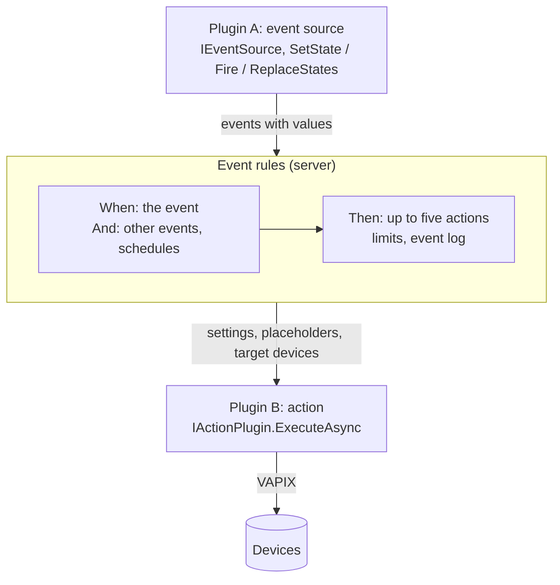

The event rules are built into the server: "when this happens, do that". Both sides come from plugins. An **action**
is something a rule does (send an email, set an output). An **event source** tells the rules that something happened
(an input changed, a detection turned on). The server keeps the rules, works out when a rule turns on and off, runs
the actions and writes the event log.



Plugin A and plugin B never know about each other: an administrator connects them with a rule.

## Write an action

An action is one class that implements `IActionPlugin` in a `*.Server.dll`. It needs no client part: the rule dialog
draws its settings form from `Fields`. The [event rule action tutorial](../tutorial-action/) builds one with every file
and its tests; `./manage.sh new action --name "My action"` creates a working copy.

### The parts

| Member | Purpose |
|---|---|
| `NeedsDevice` | True: the rule picks target devices; `ExecuteAsync` runs once per device with `ctx.Vapix` logged in to it |
| `Fields` | The settings form: `Text`, `Multiline`, `Number`, `Bool`, `Choice`, `DynamicChoice`, `Password`, `Code`, `KeyValues` |
| `Validate(settings, statefulRule)` | Your own checks beyond required fields, numbers and lengths; errors per field key |
| `Describe(settings)` | The short text of the rules list ("Virtual input 64") |
| `SupportsTurnOff`, `RunsOn(edge, settings)` | Whether the action also runs when a rule turns off |
| `UsesPlaceholders` | The dialog lists the placeholders next to the form |
| `MaxRunTime(settings)` | More than the 30 s a run gets, e.g. a pulse the device answers only after it ended |
| `ListChoicesAsync` | The choices of a `DynamicChoice` field, read while the rule is edited |

A field can carry `Required`, `Hint`, `Default`, `Min` / `Max`, `MaxLength`, `VisibleWhenKey` / `VisibleWhenValue` (show
it only for one choice of another field) and `OffEdge` (a setting of "When the rule turns off"). The same checks run in
the dialog and on the server.

### Running

- `invocation.Edge` is `Fired` (a one-shot rule), `TurnedOn` or `TurnedOff`. `invocation.Get(key)`, `GetInt`,
  `GetBool`, `GetPairs` read the settings.
- Throw for a failure: the message goes into the event log. There is no retry. At most 16 runs go at once for all rules.
- Devices that refuse the login are skipped before your action is called.
- `ctx.Text(text)` fills the placeholders: `{rule}`, `{event}`, `{state}`, `{time}`, `{device}`, `{address}`, `{model}`,
  `{serial}`, `{tags}`, ..., and every value of the event by its name (`{port}`). `ctx.Text(text,
  PlaceholderEscape.Json)` (or `Xml`, `Url`) escapes each value for a body or a URL.
- `Password` fields are stored encrypted and never sent back to a client. `ctx.Settings` are the plugin's settings.
- An action without devices gets **Send test** in the rule dialog, with sample values.

A core plugin can contribute actions through `IActionSource.ActionPlugins`; they share its state and settings and are
available while the plugin is on. VAPIX Commander's "Run VAPIX command" works this way.

## Publish events

A core plugin declares its event types by implementing `IEventSource` and publishes through `ctx.EventPublisher`.
This one declares "Old AXIS OS" and reports it after every check round of the firmware overview of the
[plugin page tutorial](../tutorial-page/):

```csharp
using Oadm.Sdk.Events;
using Oadm.Sdk.Plugins;

/// <summary>Declares an event and publishes it from a core plugin.</summary>
public sealed class OldFirmwareEvents : IEventSource
{
    public const string OldFirmware = "acme.firmware-overview.old";

    public IReadOnlyList<EventTypeInfo> EventTypes { get; } =
    [
        new(OldFirmware, "Old AXIS OS", "Firmware overview", EventKind.Stateful, EventScope.Device)
        {
            Description = "The device runs an AXIS OS older than 12.0.",
        },
    ];

    /// <summary>After every check round: the full picture. The server works out what turned on and off.</summary>
    public static void Report(ICorePluginContext ctx, IEnumerable<FirmwareRow> rows)
    {
        if (ctx.EventPublisher is not { } events || !events.IsWatched(OldFirmware))
        {
            return; // no rule uses it
        }

        events.ReplaceStates(OldFirmware, [.. rows.Where(IsOld).Select(r => r.DeviceId)]);
    }

    private static bool IsOld(FirmwareRow row) =>
        Version.TryParse(row.Version, out var version) && version.Major < 12;
}
```

| Kind | Meaning | Publish with |
|---|---|---|
| `Stateful` | On or off per device (or for the server), off by default: "Blur detected", "Input 1 active" | `ReplaceStates(type, onDevices)` or `SetState(type, device, isOn, data)` |
| `Stateless` | Something happened once: "Rollout failed" | `Fire(type, device, data)` |

- **Ready.** After every start, send one `ReplaceStates` per stateful type: that tells the server your picture is
  complete. Until then (at most 2 minutes) it keeps the states from before the restart and runs nothing for the type. Later send changes
  with `SetState`, or `ReplaceStates` again whenever that is easier: the server works out what changed.
- **Values.** The `data` of `SetState` and `Fire` are the event's values; `ReplaceStates` carries none, so publish with
  `SetState` when actions need values. Actions use them as placeholders (`{version}`), conditions can
  filter on the declared `EventField`s.
- **Cheap when unused.** Calls only queue. `IsWatched(type)` says whether an enabled rule uses the type; skip work
  nobody needs.
- **Types that change.** A source whose types the user creates (Device triggers) implements `IDynamicEventSource` and
  raises `EventTypesChanged`.

## Built-in examples

| Plugin | Shows |
|---|---|
| `plugins/Oadm.Plugins.Outputs` | A device action with choices, a field shown for one choice, turn off |
| `plugins/Oadm.Plugins.Notifications` | Actions without devices, code bodies, name and value rows, escaping |
| `plugins/Oadm.Plugins.VapixCommander` (`RunCommandAction`) | An action contributed by a core plugin, dynamic choices |
| `plugins/Oadm.Plugins.DeviceTriggers` | Dynamic event types, a WebSocket per device, "connection lost" |

## Reference

Every member with its signature in the [SDK reference](../../api/): [`IActionPlugin`](../../api/sdk/actions/iactionplugin/), [`IActionContext`](../../api/sdk/actions/iactioncontext/), [`ActionField`](../../api/sdk/actions/actionfield/), [`ActionInvocation`](../../api/sdk/actions/actioninvocation/), [`ActionPlaceholders`](../../api/sdk/actions/actionplaceholders/), [`IEventSource`](../../api/sdk/events/ieventsource/), [`IEventPublisher`](../../api/sdk/events/ieventpublisher/), [`EventTypeInfo`](../../api/sdk/events/eventtypeinfo/).
