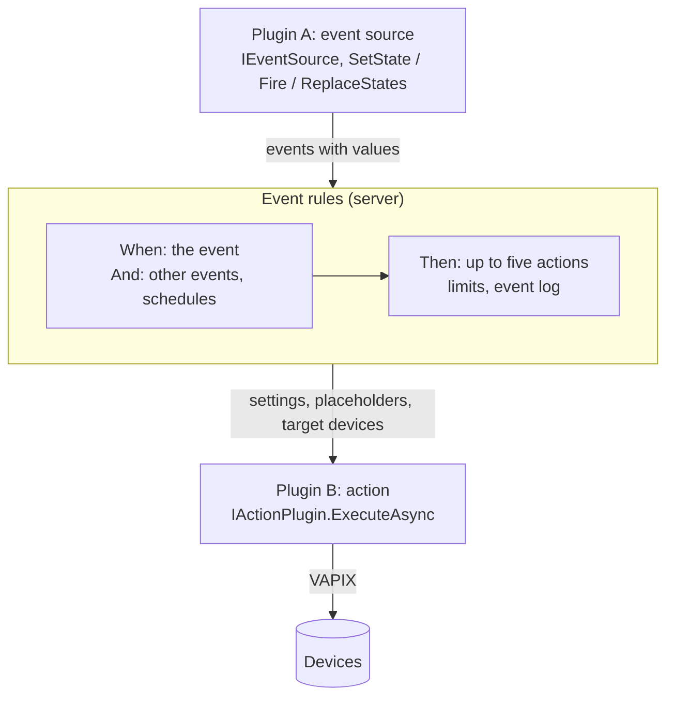

The event rules are built into the server: "when this happens, do that". Both sides come from plugins. An **action**
is something a rule does (send an email, set an output). An **event source** tells the rules that something happened
(an input changed, a detection turned on). The server keeps the rules, works out when a rule turns on and off, runs
the actions and writes the event log.



Plugin A and plugin B never know about each other: an administrator connects them with a rule.

## Write an action

An action is one class that implements `IActionPlugin` (`Oadm.Sdk.Actions`) in a `*.Server.dll`: a public class with a
parameterless constructor, which the loader registers like a task plugin. It needs no client part: the rule dialog
draws its settings form from `Fields`. The [event rule action tutorial](../tutorial-action/) builds one with every file
and its tests; `dotnet new oadm-action -n MyAction` creates a working copy (in a checkout of OADM:
`./manage.sh new action --name "My action"`).

### The parts

| Member | Purpose |
|---|---|
| `NeedsDevice` | True: the rule picks target devices; `ExecuteAsync` runs once per device with `ctx.Vapix` logged in to it |
| `Fields` | The settings form: `Text`, `Multiline`, `Number`, `Bool`, `Choice`, `DynamicChoice`, `Password`, `Code`, `KeyValues`, `File`, `Recipient`, `ClientCertificate`, `TrustedCertificate` |
| `RecipientTypes` | The kinds of recipient the plugin declares (SDK 0.11.0, default none) |
| `Validate(settings, statefulRule)` | Your own checks beyond required fields, numbers and lengths; errors per field key |
| `Describe(settings)` | The short text of the rules list ("Virtual input 64") |
| `SupportsTurnOff`, `RunsOn(edge, settings)` | Whether the action also runs when a rule turns off |
| `UsesPlaceholders` | The dialog lists the placeholders next to the form |
| `MaxRunTime(settings)` | More than the 30 s a run gets, e.g. a pulse the device answers only after it ended |
| `ListChoicesAsync` | The choices of a `DynamicChoice` field, read while the rule is edited |

A field can carry `Required`, `EmptyText` (SDK 0.11.0: the error when a required field is empty, default "Enter" and
the label), `Format` (SDK 0.11.0: Url, Host, Email or EmailList; SDK 0.12.0: OpcEndpoint; checked while the user types
and on the server), `Hint`, `Default`, `Min` / `Max`, `MaxLength`, `VisibleWhenKey` / `VisibleWhenValue` (show it only
for one choice of another field, e.g. "Seconds" for "Pulse"; several values as "basic|digest"), `AlsoVisibleWhenKey` /
`AlsoVisibleWhenValue` (SDK 0.12.0: a second condition, either one shows it) and `OffEdge` (a setting of "When the rule
turns off", shown only for rules that turn on and off). The host checks required values, numbers, choices and lengths
with the same code in the dialog and on the server; `Validate` adds your own rules.

The field kinds: `DynamicChoice` reads its list from `ListChoicesAsync` while the rule is edited (saved VAPIX
commands). `Code` is a body in the code editor; `Language`, or `LanguageKey` naming the field whose value is json, xml,
html, text or form, sets its coloring. `KeyValues` are name and value rows, read with `invocation.GetPairs(key)`.

```csharp
public IReadOnlyList<ActionField> Fields { get; } =
[
    ActionField.Text("to", "To", required: true),
    ActionField.Text("subject", "Subject", defaultValue: "{event} on {device}"),
    ActionField.Multiline("body", "Message"),
    ActionField.Password("smtpPassword", "SMTP password"),   // stored encrypted, never sent back to a client
];

public async Task ExecuteAsync(IActionContext ctx, ActionInvocation invocation, CancellationToken ct)
{
    var subject = ctx.Text(invocation.Get("subject"));       // placeholders filled
    await Smtp.SendAsync(invocation.Get("to")!, subject, ctx.Text(invocation.Get("body")), invocation.Get("smtpPassword"), ct);
    ctx.Log("Sent to " + invocation.Get("to"));              // one line in the event log entry (OADM turns line breaks into spaces); never a secret
}
```

### Running

- `invocation.Edge` is `Fired` (a one-shot rule), `TurnedOn` or `TurnedOff`. `invocation.Get(key)`, `GetInt`,
  `GetBool`, `GetPairs` read the settings. Set `SupportsTurnOff` when the action has an off part, and answer
  `RunsOn(edge, settings)` to skip edges (default: off edges only with `SupportsTurnOff`).
- Throw for a failure: the message goes into the event log. There is no retry. At most 16 runs go at once for all
  rules, 30 s each (`ct` is cancelled then; `MaxRunTime(settings)` asks for longer).
- Devices that refuse the login are skipped before your action is called.
- `ctx.Text(text)` fills the placeholders: `{rule}`, `{event}`, `{state}`, `{time}`, `{device}`, `{address}`, `{model}`,
  `{serial}`, `{tags}`, `{site}` (the device's site, or the site of a "Site offline" event), ..., and every value of the
  event by its name (`{port}`). `ctx.Text(text,
  PlaceholderEscape.Json)` (or `Xml`, `Url`) escapes each value for a body or a URL, never the text around it;
  `SingleLine` turns a line break of a value into a space and removes its other control characters, so it never adds a
  line to a text protocol where a line is a command. `ActionPlaceholders.Fixed` lists the fixed placeholders. `ActionPlaceholders.FirstUnknown(text, ctx)` names a
  `{name}` the run does not fill, for an action that must not send it as it is.
- `Password` fields are stored encrypted and never sent back to a client. `ctx.Settings` are the plugin's settings
  (the package's, or the owning core plugin's): an SMTP server, for example.
- An action without devices gets **Send test** in the rule dialog, with sample values (Log entry is the one exception).
  It is off on a persistent recipient: Test the recipient instead.

### Recipients

A recipient (SDK 0.11.0) is a shared target several rules choose: a mail address, an HTTP endpoint, a PLC.

- Declare a `RecipientType(id, name, icon, fields, testActionId)` in `RecipientTypes`, with an optional `Target` such as
  `"{host}:{port}"` for the Recipients list, and add `ActionField.Recipient("recipient", "Recipient", [typeId])` to
  `Fields`.
- Before a run the host merges the recipient's fields into the settings under their own keys, so
  `invocation.Get("host")` works and passwords arrive decrypted. `invocation.RecipientIds` has the id per field.
- Never fill placeholders in a target. `Validate` also checks a recipient's values, and `Describe` sees them without
  passwords.
- An action without its recipient does not run: "Choose a recipient.".

### Recipient sessions

A persistent recipient (SDK 0.12.0: MQTT, Modbus, OPC UA) is one open connection that every rule choosing the recipient
shares. Set `RecipientType.Sessions` to an `IRecipientSessionFactory`:

```csharp
public static readonly RecipientType Plc = new("acme.plc.recipient", "PLC", "network",
    [ActionField.Text("host", "Host", required: true), ActionField.Number("port", "Port", 1, 65535, 502)], WriteAction.ActionId)
{
    Sessions = new PlcSessions(),
};

public sealed class PlcSessions : IRecipientSessionFactory
{
    public IRecipientSession Create(RecipientSessionRequest request) =>
        new PlcSession(request.Get("host")!, request.GetInt("port", 502));   // not connected yet
}

// The session: ConnectAsync opens the connection and checks the login, Dropped tells the host it ended by itself.
// What it can send is your own interface; the host never knows the protocol.
public async Task ExecuteAsync(IActionContext ctx, ActionInvocation invocation, CancellationToken ct)
{
    var plc = await ctx.SessionAsync<IPlcSession>("recipient", ct);
    await plc.WriteAsync(invocation.GetInt("register", 0), invocation.GetBool("value"), ct);
}
```

- The host opens the session at the first action that needs it, opens a new one after it dropped and closes it. The
  Recipients card shows its status live: Connected, Connecting, Not connected with the reason.
- The first action of a recipient waits for its connection. Later ones fail at once while it is not connected; nothing
  is queued.
- Several actions use a session at the same time: a protocol that sends one request at a time keeps its own order.
- The recipient's passwords reach only the session (`RecipientSessionRequest.Settings`), never the action.
- Test of such a type only connects and answers `RecipientSessionTexts.Connected`; it sends nothing.
- `ActionField.ClientCertificate` and `ActionField.TrustedCertificate` (SDK 0.12.0) are selects of the certificates in
  PKI, optional by default, only for fields of a recipient type. A plugin never searches PKI:
  `RecipientSessionRequest.CertificatesOf(key)` gives the chosen certificate first, then its issuers, a client
  certificate with its private key. A certificate a recipient uses cannot be deleted on the PKI page.

A core plugin can contribute actions through `IActionSource.ActionPlugins`; they share its state and settings and are
available while the plugin is on. VAPIX Commander's "Run VAPIX command" works this way.

## Publish events

A core plugin declares its event types by implementing `IEventSource` (`Oadm.Sdk.Events`) and publishes through
`ctx.EventPublisher`, which is null on a host without event rules. An event type has an id, a name, a group for the
picker, a kind, a scope (per device or for the server) and optional data fields a condition can check.
This one declares "Old AXIS OS" and reports it after every check round of the AXIS OS overview of the
[plugin page tutorial](../tutorial-page/):

```csharp
using Oadm.Sdk.Events;
using Oadm.Sdk.Plugins;

/// <summary>Declares an event and publishes it from a core plugin.</summary>
public sealed class OldFirmwareEvents : IEventSource
{
    public const string OldFirmware = "acme.firmware-overview.old";

    public IReadOnlyList<EventTypeInfo> EventTypes { get; } =
    [
        new(OldFirmware, "Old AXIS OS", "AXIS OS overview", EventKind.Stateful, EventScope.Device)
        {
            Description = "The device runs an AXIS OS older than 12.0.",
        },
    ];

    /// <summary>After every check round: the full picture. The server works out what turned on and off.</summary>
    public static void Report(ICorePluginContext ctx, IEnumerable<FirmwareRow> rows)
    {
        if (ctx.EventPublisher is not { } events || !events.IsWatched(OldFirmware))
        {
            return; // no rule uses it
        }

        events.ReplaceStates(OldFirmware, [.. rows.Where(IsOld).Select(r => r.DeviceId)]);
    }

    private static bool IsOld(FirmwareRow row) =>
        Version.TryParse(row.Version, out var version) && version.Major < 12;
}
```

| Kind | Meaning | Publish with |
|---|---|---|
| `Stateful` | On or off per device (or for the server), off by default: "Blur detected", "Input 1 active" | `ReplaceStates(type, onDevices)` or `SetState(type, device, isOn, data)` |
| `Stateless` | Something happened once: "Rollout failed" | `Fire(type, device, data)` |

- **Ready.** After every start, send one `ReplaceStates` per stateful type: that tells the server your picture is
  complete. Until then (at most 2 minutes) it keeps the states from before the restart and runs nothing for the type. Later send changes
  with `SetState`, or `ReplaceStates` again whenever that is easier: the server works out what changed.
- **Values.** The `data` of `SetState` and `Fire` are the event's values; `ReplaceStates` carries none, so publish with
  `SetState` when actions need values. Actions use them as placeholders (`{version}`), conditions can
  check the declared `EventField`s ("Temperature > 40", SDK 0.9.0: `RuleCondition.Checks`); a check on a value the
  event did not send fails, so a state set by `ReplaceStates` alone never passes one.
- **One device.** `FixedDeviceId` on the type (SDK 0.10.0) names the device an event belongs to, for an object that sits
  on one device (a reader on its camera). Dashboards then asks for no device and follows it; raise `EventTypesChanged`
  when it changes. Set `DeviceIds` to the same device.
- **Separate values.** `SplitField` on the type (SDK 0.10.0) names a Choice field, for an event sent once per part (per
  area). Dashboards keeps the latest value per choice and asks for one. Every event of the type carries the field, also
  the off of an on and off event; raise `EventTypesChanged` when its `Values` change.
- **Devices.** `DeviceIds` on the type lists the devices that can send it now (null: any device); raise `EventTypesChanged`
  when they change. Dashboards offers only these devices for a widget.
- **Folders.** `Path` (SDK 0.10.0) puts the event in the rule dialog's tree, top first: `["Certificates", "EST server"]`.
  At most 4 folders, none of them blank; a path that breaks this is dropped (the server logs it) and the event sits in
  its `Group`. Without a path and without a group the folder is "Other". At the top Devices, Certificates and Sites come
  first, then the other areas by name. Use an existing area where the event fits (Devices with Selected devices and Any
  device; Certificates; Sites). A name that starts with its last folder ("Any device: unreachable" in "Any device")
  shows without it there.
- **Fields.** An `EventField` has a name, a label, `Kind` (`EventValueKind`: `Text`, `Number`, `YesNo`; what the value
  holds: the operators of a check in a rule, the widget of a dashboard; without it, `Type` `Number` gives a number) and `Filter` (default true; false = a value only: a placeholder, no
  check in the rule dialog, for counts and names that are only for display).
- **Cheap when unused.** Calls only queue. `IsWatched(type)` says whether an enabled rule or a subscriber uses the type;
  skip work nobody needs. `IsUsedByRule(type)` (SDK 0.10.0) counts enabled rules only, never subscribers such as
  Dashboards.
- **Tests.** `Oadm.Sdk.Testing.FakeEventPublisher` records what the source fires and switches (`Published`, `States`);
  `UseInRule(type)` makes `IsUsedByRule` true, `Watched` sets what `IsWatched` answers. Hand it to the context:
  `new FakeCoreContext { EventPublisher = new FakeEventPublisher() }`.
- **Types that change.** A source whose types the user creates (Device triggers) implements `IDynamicEventSource` and
  raises `EventTypesChanged` after `EventTypes` changed. A new stateful type waits for its first `ReplaceStates`; a
  removed type counts as off. The types are read once before `StartAsync`, so a plugin that loads its types from its
  settings raises the event in `StartAsync`; rules that use them wait for them meanwhile.

## Subscribe to events

A core plugin can receive every event the server handles, its own, other plugins' and OADM's (Device unreachable,
Certificate expires soon): `ctx.EventSubscriptions?.Subscribe(handler)` returns a subscription; dispose it to stop. The
host also ends a plugin's subscriptions when it stops or is turned off.

```csharp
_subscription = ctx.EventSubscriptions?.Subscribe(e =>
{
    // e.TypeId, e.DeviceId (null for server events), e.Kind (On, Off, Fired), e.Data, e.Time, e.FromSnapshot
    _latest[(e.TypeId, e.DeviceId)] = e;
});
```

- A subscription starts with every stateful event that is on now (`FromSnapshot` true), then the live events in the
  order the server handled them. `ctx.EventSubscriptions` is null on a host without event rules.
- While any plugin subscribes, `IsWatched` is true for every type, so sources never skip events a subscriber needs.
- The handler runs on the subscription's own loop, one event at a time. Keep it short. The server never waits for it:
  10,000 events wait at most, then the oldest are dropped (logged).
- An exception in the handler is logged; the subscription goes on.
- `Types` lists every event type with its fields, its source and whether the source's plugin is on; `TypesChanged` fires
  when that list changed. The [Dashboards](../../tools/dashboards/) plugin builds its event list from it.

## Built-in examples

| Plugin | Shows |
|---|---|
| `plugins/Oadm.Plugins.Outputs` | A device action with choices, a field shown for one choice, turn off |
| `plugins/Oadm.Plugins.Notifications` | Actions without devices, code bodies, name and value rows, escaping |
| `plugins/Oadm.Plugins.VapixCommander` (`RunCommandAction`) | An action contributed by a core plugin, dynamic choices |
| `plugins/Oadm.Plugins.DeviceTriggers` | Dynamic event types, a WebSocket per device, "connection lost" |

## Reference

Every member with its signature in the [SDK reference](../../api/): [`IActionPlugin`](../../api/sdk/actions/iactionplugin/), [`IActionContext`](../../api/sdk/actions/iactioncontext/), [`ActionField`](../../api/sdk/actions/actionfield/), [`ActionInvocation`](../../api/sdk/actions/actioninvocation/), [`ActionPlaceholders`](../../api/sdk/actions/actionplaceholders/), [`IEventSource`](../../api/sdk/events/ieventsource/), [`IEventPublisher`](../../api/sdk/events/ieventpublisher/), [`EventTypeInfo`](../../api/sdk/events/eventtypeinfo/).
