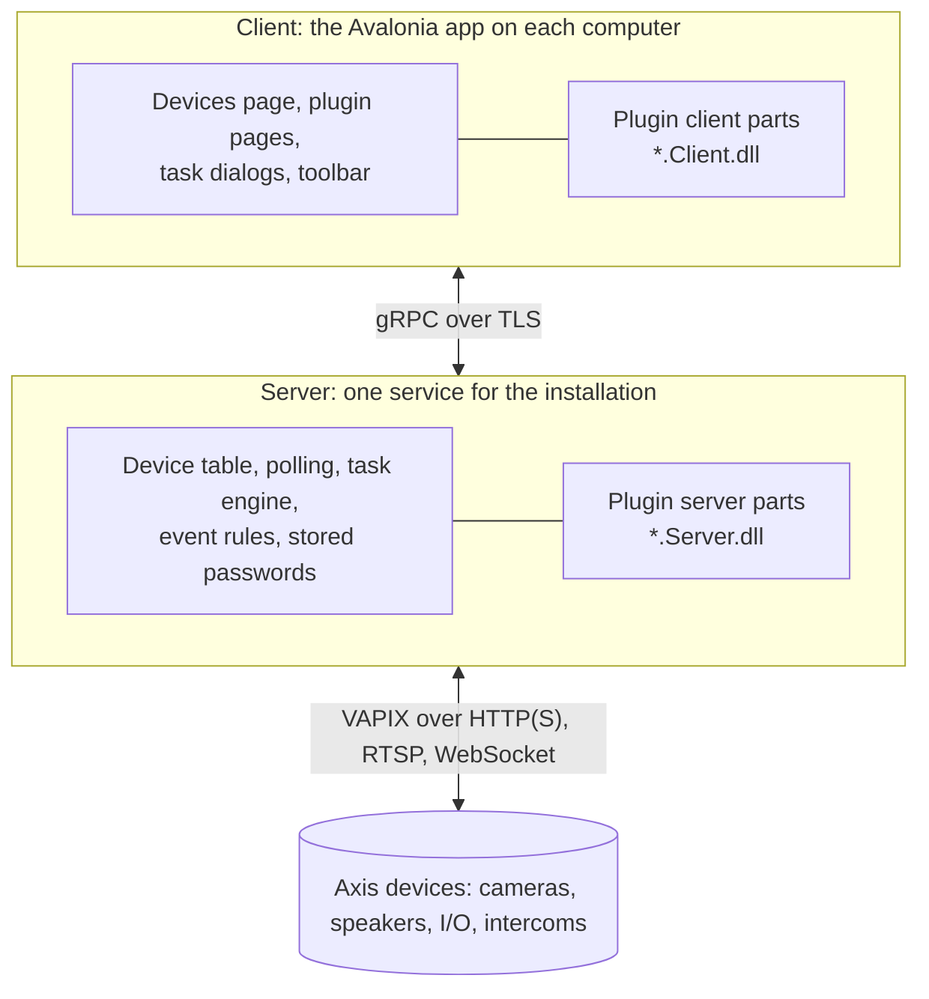

OADM is written in C# on .NET 10. Most of what you see in the app is a plugin, built on the same SDK that is open to
you. This section explains how OADM is put together, what a plugin can do and how to write one.

## Two processes

- **The server owns everything**: the device table, the stored passwords, the tasks, discovery, polling and every
  request to a device. It runs as a service on Windows, Linux and macOS.
- **The client is a thin UI.** It never talks to a device. It sends requests to the server over gRPC and keeps a live
  copy of the device and task lists.
- **Passwords never leave the server.** A plugin gets a VAPIX client that is already logged in, never the password.

A plugin follows the same split: a **server part** (`*.Server.dll`) does the device work, an optional **client part**
(`*.Client.dll`) shows a dialog, a page or a toolbar button.

## What a plugin can do

| You want to | Build | Example in the repository |
|---|---|---|
| Change or read something on many devices from the context menu | [Task plugin](../tasks/) | Restart, Users, Upgrade firmware |
| Ask the user first (a form, a file) | Task plugin with a [dialog](../tasks/#the-dialog) | Date and time, Applications |
| Run a service or show a page in the navigation rail | [Core plugin](../core-plugins/) | NTP server, Edge storage, PKI |
| Add a button to the Devices toolbar | [Toolbar plugin](../core-plugins/#toolbar-buttons) | System report |
| Do something when an event rule fires | [Action](../event-rules/#write-an-action) | Send email, Set output |
| Let event rules react to something your plugin sees | [Event source](../event-rules/#publish-events) | Device triggers |
| Add a kind of check to the Compliance page | [Compliance check type](../compliance-checks/) | Application running, SD card |

Inside these, the SDK gives you:

- every managed device with its model, firmware, status, tags and API list ([Devices and VAPIX](../devices/));
- a logged-in VAPIX client per device, with WebSockets, RTSP event streams and video source lists;
- tasks with named steps, progress, a log and warnings, one task per device;
- settings per plugin, encrypted secrets, a private data folder;
- live events from the server part to its page, file downloads to the client;
- the shared controls and theme of the app, so a plugin looks like the rest of OADM ([UI kit](../ui/));
- permissions that administrators give per role on the **Permissions** page.

## Where the code is

| Folder | Content |
|---|---|
| `src/Oadm.Sdk` | The server SDK: plugin interfaces, devices, VAPIX, tasks, events, actions. No UI |
| `src/Oadm.Sdk.Client` | The client SDK: dialog, page and toolbar interfaces, shared controls, validation |
| `src/Oadm.Sdk.Testing` | Fakes for plugin tests: a camera, a device, the server's contexts |
| `src/Oadm.Plugin.Sdk` | The project SDK of plugins: references, `plugin.json`, the plugin folder |
| `src/Oadm.Core` | Device model, VAPIX client, discovery, task engine, database |
| `src/Oadm.Server` | The server host: gRPC services, plugin loader, polling |
| `src/Oadm.Client` | The Avalonia app |
| `src/Oadm.Contracts` | The gRPC contracts (`.proto`) |
| `plugins/` | Every built-in plugin, each with its own `README.md` |
| `tests/` | Unit, headless UI, performance and hardware tests |
| `samples/`, `templates/`, `tools/Oadm.Tools` | The tutorials' plugins, the `dotnet new` templates made from them, the `oadm` command |

All of the SDK is on NuGet with every release, in the release's version; you need no checkout to write a plugin.

The SDK sources are the reference: every member has a comment that says what it does and what the host guarantees.
Start with `src/Oadm.Sdk/Plugins/Plugins.cs` and `src/Oadm.Sdk.Client/ClientPlugins.cs`.

## Where to go next

1. [Develop with the .NET SDK](../plugin-sdk/): `dotnet new oadm-task`, a development server, debugging, shipping.
2. [Plugin basics](../plugins/): project layout, `plugin.json`, how plugins load.
3. A tutorial, each on one page with every file: [task plugin](../tutorial-task/), [plugin page](../tutorial-page/),
   [event rule action](../tutorial-action/). `dotnet new oadm-task|oadm-page|oadm-action` creates the tutorial's plugin
   under your name, ready to build and run.
4. [Build from source](../build/): OADM itself from a checkout.
5. The topic pages: [Devices and VAPIX](../devices/), [Task plugins](../tasks/), [Core plugins and pages](../core-plugins/),
   [Event rules](../event-rules/), [Compliance checks](../compliance-checks/), [Sites](../sites/), [UI kit](../ui/), [Testing](../testing/), [Debug a plugin](../debugging/),
   [SDK versions](../compatibility/), [Sell a plugin with a license](../licenses/).
6. [Build a plugin with AI](../ai-plugins/): write a plugin together with an AI coding assistant.

Every public type and member, with its signature and comment, is in the [SDK reference](../../api/). The
rules and edge cases are in
[plugins/README.md](https://github.com/Cacsjep/oadm/blob/main/plugins/README.md) and the spec,
[CLAUDE.md](https://github.com/Cacsjep/oadm/blob/main/CLAUDE.md) and
[docs/spec/](https://github.com/Cacsjep/oadm/tree/main/docs/spec).
