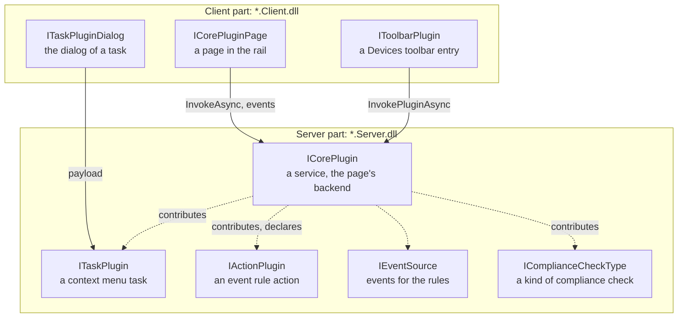

A plugin is a folder with a `plugin.json`, a server assembly and, when it has a UI, a client assembly. The server
loads the first, the client the second. Both come from the same folder.

## Plugin kinds

| Kind | Interface | Lives in | Shows up as |
|---|---|---|---|
| Task plugin | `ITaskPlugin` | `*.Server.dll` | An entry in the device context menu, optionally a toolbar button |
| Task dialog | `ITaskPluginDialog` | `*.Client.dll` | The window that opens before a task runs |
| Core plugin | `ICorePlugin` | `*.Server.dll` | A service on the server, usually with a page |
| Core plugin page | `ICorePluginPage` | `*.Client.dll` | A page in the navigation rail |
| Toolbar plugin | `IToolbarPlugin` | `*.Client.dll` | A control in the Devices toolbar |
| Action | `IActionPlugin` | `*.Server.dll` | A "Then" choice in the event rules |
| Compliance check type | `IComplianceCheckType` | `*.Server.dll` | A kind of check on the **Compliance** page |

One folder can hold several of them. The PKI plugin, for example, is one core plugin with a page that also contributes
nine task plugins to the context menu.



## Start from a working plugin

```sh
dotnet new install Oadm.Plugin.Templates
dotnet new oadm-task -n MyPlugin      # or oadm-page, oadm-action
```

This creates the plugin of the matching tutorial under your name, with its tests: it builds, its tests pass, and it runs
on the development server (`dotnet oadm dev start`). The tutorials explain every file:
[task plugin](../tutorial-task/), [plugin page](../tutorial-page/), [event rule action](../tutorial-action/). The tools
around it: [Develop with the .NET SDK](../plugin-sdk/).

## Project layout

```text
MyPlugin/
  MyPlugin.slnx
  Directory.Build.props          .NET 10, the plugin folder .oadm/plugins/
  MyPlugin/                      server part: MyPlugin.Server.dll
    MyPlugin.csproj
    MyPluginTaskPlugin.cs
  MyPlugin.Client/               client part (optional): MyPlugin.Client.dll
    MyPlugin.Client.csproj
    MyPluginDialog.cs
  MyPlugin.Tests/
```

### The project files

Both parts use the project SDK `Oadm.Plugin.Sdk`. It names the assemblies after the project (`.Server.dll`, and
`.Client.dll` for a project ending in `.Client`), references the OADM SDK without copying it (the host has it), writes
`plugin.json` from the server project's properties and copies the plugin folder to `.oadm/plugins/<id>/` after every
build:

```xml
<Project Sdk="Oadm.Plugin.Sdk/4.5.0">
  <PropertyGroup>
    <OadmPluginId>acme.hello</OadmPluginId>
    <Version>1.0.0</Version>
    <OadmDisplayName>Hello</OadmDisplayName>
    <OadmDescription>Says hello to devices.</OadmDescription>
  </PropertyGroup>
</Project>
```

The client project names the same `OadmPluginId` and references the server project to share the payload types. Avalonia,
the MVVM toolkit and `Avalonia.Controls.DataGrid` (without a version) come from the OADM client and are never copied;
other packages go into the plugin folder with your plugin.

### plugin.json

| Property | Field | Meaning |
|---|---|---|
| `OadmPluginId` | `id` | Unique and stable. It names the folder, the settings and the permissions. Never change it |
| `Version` | `version` | Your plugin's version |
| (the SDK's) | `minSdkVersion` | The SDK your plugin is built with (`SdkInfo.Version`). An older host skips the plugin and logs why. Below 0.4.0 users with a device group cannot use it, see [SDK versions](../compatibility/#plugins-built-before-040) |
| `OadmDisplayName`, `OadmDescription` | `displayName`, `description` | The row on the **Plugins** page: the name and one short sentence |
| `OadmEnabledByDefault` | `enabledByDefault` | `false`: off until an administrator turns it on. Use it for anything that runs in the background |
| `OadmLicense...` | `license` | A plugin you sell: [Sell a plugin with a license](../licenses/) |
| `OadmSiteSupport` | `siteSupport` | `full` (default): works with devices at a site; `none`: the host keeps it away from them, see [Sites](../sites/) |
| `OadmSitePorts` | `sitePorts` | Ports your plugin listens on at sites: `udp:514:Syslog;tcp:8080:Reports` |
| `OadmBannedApis` | (none) | `warning` (default): the banned-API analyzer warns (RS0030) when your code opens its own socket, HTTP handler or DNS lookup; `none` turns it off. Inside the OADM repository plugins build with `error`, see [Sites](../sites/) |

A `plugin.json` of your own in the server project is used as it is instead. `alwaysOn` (it cannot be turned off) is
reserved for the plugins of OADM.

## How plugins load

- The server looks in `plugins/<id>/` next to its exe, in `<data folder>/plugins/<id>/` and, in a checkout of OADM, in
  `artifacts/plugins/<id>/`. The client looks in the same three places.
- Each plugin folder loads in its own load context. Your private dependencies (NuGet packages the host does not have) go into
  the plugin folder with it.
- The loader finds every public class that implements a plugin interface and has a public parameterless constructor.
  Contributed task plugins and actions come from their core plugin instead.
- A plugin that fails to load or throws is logged and skipped. It never stops the server or the client.
- Administrators turn plugins on and off on the **Plugins** page. A plugin that is off has no page, menu entry or toolbar
  button, and its core plugins are stopped. Tasks already running finish.

- `--Oadm:PluginDir=<folder>` (server) and `--plugin-dir <folder>` (client) load one plugin folder straight from a build,
  before the others: the development server and `oadm debug --installed` use them. An installed service ignores them.

To try a plugin, build it and start the development server in its folder (`dotnet oadm dev start`, then
`dotnet oadm dev client`). To install it in the OADM on your computer, run `dotnet oadm deploy --installed`; for others,
`dotnet oadm pack` writes the `.oadmplugin` file. See [Develop with the .NET SDK](../plugin-sdk/).

## Rules every plugin follows

These rules hold for the built-in plugins too. Pull requests that break them are not merged.

- **Device safety.** Check the device's API versions before the first write, validate every input before you touch the
  device, never lock OADM out (never remove or demote the account OADM uses), and write the setting that could cut the
  connection last. Details in [Task plugins](../tasks/#device-safety).
- **Trust.** Your plugin runs with the server's rights (Local System or root as a service) and reaches every managed
  device. Administrators are told to install only plugins they trust: keep yours small, open and free of surprises.
- **The user's devices.** A method reaches devices only through the user's call (`caller.*`), never `ctx.*`: a user can
  be limited to a device group. See [Device groups](../device-groups/).
- **Network.** Never open your own sockets: reach devices through the host (`IVapixClient`, `ctx.EventStreams`,
  `ctx.Network` / `IDeviceNetwork`), so devices at a site work too. The build warns (RS0030). See [Sites](../sites/).
- **Secrets.** Payloads live in memory only. Never log or store a password; store secrets only encrypted
  (`ctx.Secrets`).
- **Steps and names.** Every device request and every wait is a named step. The task name says what the task does.
- **Scale.** A server can manage 30,000 devices. Lists are virtualized, searches are one pass, server work for many devices
  runs with bounded parallelism, and every device list has a test with 30,000 fake devices.
- **Look.** Shared controls and theme only, errors directly below the field, one accent button per view, red for
  destructive actions. See [UI kit](../ui/).
- **Wording.** Short and plain, no protocol names in UI text, button labels without "...".
- **Tests.** Every non-trivial class has tests with fakes. No test needs a network or a device. See [Testing](../testing/).
- **Documentation.** Every plugin has a `README.md` in its folder: decisions, page or dialog, steps, the device API it
  uses and what was verified on which device.
