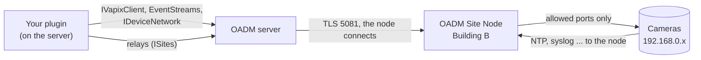

A **site** is a network the OADM server cannot reach itself: another building, a camera network behind a second network
card. An **OADM Site Node** runs there and is OADM's foot in it. Devices at a site are managed like every other device;
the server sends their traffic through the site node, with TLS and the login end to end.

Most plugins work at sites without a change. This page says what your plugin declares, how it checks the network
towards a device, how it offers a server to devices at a site, and how you test it.



## The rules

- **Never open your own sockets to devices.** Reach them through `IVapixClient` (HTTP, HTTPS, WebSockets),
  `ICorePluginContext.EventStreams` (RTSP) and `IDeviceNetwork` (below). The host routes all of them through the
  device's site. The project SDK warns (RS0030) when your code uses `Socket`, `TcpClient`, `UdpClient`, `Ping`, `Dns`,
  `HttpClientHandler`, `SocketsHttpHandler` or `ClientWebSocket.ConnectAsync`.
- **Refuse what the host refuses.** A device whose site is offline has the status `SiteOffline`; use
  `DeviceMessages.Refusal(device)` or `TaskSupportReasons.ForStatus(device)`, which say "Site offline: Building B".
- **Addresses repeat.** Two sites may both use 192.168.0.20. Key devices by their id, and an address together with
  `IDeviceInfo.SiteId`.

## Declare it

The project SDK writes `siteSupport` into `plugin.json`:

| Property | plugin.json | Meaning |
|---|---|---|
| `OadmSiteSupport` | `"siteSupport": "full"` | Default. The plugin works with devices at a site |
| | `"siteSupport": "none"` | Not for devices at a site: its tasks are greyed with "Not available for devices at a site", its compliance types say Not checked, its pages and actions cannot reach such a device |
| `OadmSitePorts` | `"sitePorts": [...]` | The ports your plugin listens on at sites: `udp:514:Syslog;tcp:8080:Reports`. Shown on the Plugins page |

A `plugin.json` without `siteSupport` (a plugin built with an SDK before 0.2.0) counts as `none`. One task or one
compliance type of a package can differ: `ITaskPlugin.SiteSupport` and `IComplianceCheckType.SiteSupport` override the
package's value. Use `none` for a plugin that needs broadcast or multicast, or opens its own sockets (the DHCP server).

## Network checks towards a device

`IDeviceNetwork` checks the network on the device's route: through its site node, or on the server's own network.

| Where | Member |
|---|---|
| Task | `ITaskExecutionContext.Network` |
| Task dialog query | `ITaskQueryContext.Network` |
| Core plugin | `ICorePluginContext.Network.ForDevice(device)`, `ForSite(siteId)` (null = the server's own network) |

| Method | What |
|---|---|
| `PingAsync(address, timeout)` | The address answers a ping |
| `ProbeTcpAsync(address, port, timeout)` | The TCP port accepts a connection |
| `ResolveAsync(name)` | The addresses of a host name, as DNS on that route knows them |
| `LocalAddressTowardsAsync(address)` | OADM's address towards the device: the server's own, or the site node's in the site network |
| `Reaches(address)` | The address is in a network the route reaches (a new static address at a site must be) |

A site that cannot carry a call (offline, an old site node) throws an exception whose message says why. The Network
plugin's address-in-use check and "Use OADM as NTP server" use these.

```csharp
var network = ctx.Network ?? throw new InvalidOperationException("This OADM server cannot check addresses.");
if (!network.Reaches(IPAddress.Parse(newAddress)))
{
    throw new InvalidOperationException($"{newAddress}: {SiteTexts.OutsideSiteNetworks}. Nothing was changed.");
}

var taken = await network.PingAsync(newAddress, TimeSpan.FromSeconds(1), ct);
```

## Offer a server to devices: listeners and relays

A plugin that devices connect to (an NTP server, a syslog receiver, an HTTP endpoint) listens on the server's own network
and at every site through the same interfaces, so you write the server once:

```csharp
// The server's own network: the host binds the port and opens the firewall of the Windows service.
var local = await ctx.Network!.ListenUdpAsync(514, "Syslog", ct);

// Every site: the site node listens and passes every datagram to the plugin.
foreach (var site in ctx.Sites?.List ?? [])
{
    var relay = await ctx.Sites!.OpenUdpRelayAsync(site.Id, 514, "Syslog", ct);
    _ = ServeAsync(relay, ct);
}

async Task ServeAsync(IUdpRelay endpoint, CancellationToken ct)
{
    while (!ct.IsCancellationRequested)
    {
        var datagram = await endpoint.ReceiveAsync(ct);    // Data, Remote (the device as the node saw it)
        await endpoint.SendAsync(Reply(datagram), datagram.Remote, ct);
    }
}
```

- **UDP**: `IUdpRelay` = `IDatagramEndpoint` (`ReceiveAsync`, `SendAsync`). **TCP**: `ITcpRelay` = `IStreamListener`
  (`AcceptAsync` returns an `IIncomingConnection` with its `Stream`, `Remote` and `SiteId`).
- **The port is approved in the node app.** Opening a relay asks the site node for the port (Listen on, with your reason);
  until the user allows it there the relay waits. Nothing is allowed by itself.
- **State.** Every relay and listener has a `State` (`Running`, `WaitingForApproval`, `PortInUse`, `NoPermission`,
  `SiteOffline`, `NotSupported`), a `StateText` for your page ("Syslog at Building B: waiting for approval in the OADM
  Site Node app") and `StateChanged`.
- **Lifetime.** A relay reopens by itself after the node reconnects. Open relays when your feature turns on, dispose them
  when it turns off; the host closes every relay and listener of a plugin that stops or is turned off. Follow
  `ISites.SitesChanged` to open relays for new sites and dispose those of removed ones.
- **Limits.** Keep rate limits per (site, client address): two sites may have the same addresses. The NTP server keeps
  one limiter per site.

### What a relay cannot do

A relay passes datagrams and TCP connections to one port, nothing more. Declare `siteSupport: none` for a plugin that
needs any of these:

- Broadcast and multicast (DHCP, SSDP, mDNS).
- Protocols that carry addresses or ports inside (FTP passive mode, SIP, RTP to dynamic ports).
- Port ranges.
- Logic on the site node: the node is a pipe, everything runs on the server.

While the site link is down, the server is not there for the site's devices. Say so on your page (the relay's state is
`SiteOffline`).

## Test without a site node

`Oadm.Sdk.Testing` has fakes for all of it; no packet leaves the test:

| Fake | What |
|---|---|
| `FakeDeviceNetwork` | `IDeviceNetwork`: `Answering` (ping), `OpenPorts`, `Names`, `LocalAddress`, `ReachesAddress`, `Failure`; every call in `Calls`. `FakeTaskContext.Network` is one |
| `FakeSites` | `ISites`: `Add("Building B")`, `IsOnline`, `AllowedPorts`, `RelaysNotSupported`, then `Update()`; every relay in `Relays` |
| `FakePluginNetwork` | `IPluginNetwork`: the local route, each site's `FakeDeviceNetwork`, in-memory listeners in `Listeners` |
| `InMemoryUdpRelay` | `Deliver(data, from)` is a device's datagram, `ReadSentAsync` what your plugin sent |
| `InMemoryTcpRelay` | `Connect(from)` returns the device's end of a new connection |

`FakeCoreContext` brings `FakeSites` and `FakeNetwork`. The NTP server's tests (`tests/Oadm.Plugins.NtpServer.Tests/SiteServingTests.cs`)
show a server that answers through relays, its rate limits per site and the relay states on its page.

```csharp
var ctx = new FakeCoreContext();
var site = ctx.FakeSites.Add("Building B");
site.AllowedPorts.Add((SiteProtocol.Udp, 514));
await plugin.StartAsync(ctx, CancellationToken.None);      // the plugin opens its relays

var relay = ctx.FakeSites.Relays.OfType<InMemoryUdpRelay>().Single();
Assert.Equal(RelayState.Running, relay.State);
relay.Deliver("<13>door open"u8.ToArray(), new IPEndPoint(IPAddress.Parse("192.168.0.20"), 50000));
var answer = await relay.ReadSentAsync(CancellationToken.None);

site.IsOnline = false;
ctx.FakeSites.Update();                                   // every relay takes its site's state
Assert.Equal("Syslog at Building B: site offline", relay.StateText);
```
