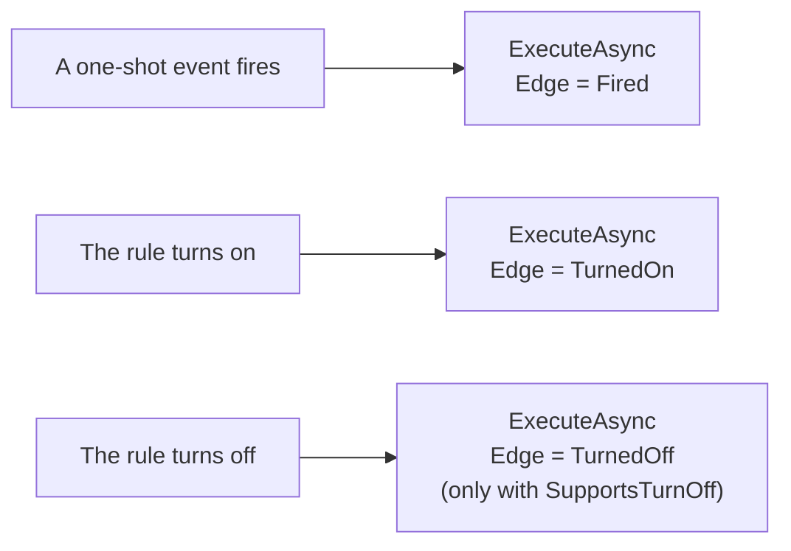

import { Code, FileTree, Aside } from '@astrojs/starlight/components';
import project from '../../../../../samples/Oadm.Samples.VirtualInput/Oadm.Samples.VirtualInput.csproj?raw';
import action from '../../../../../samples/Oadm.Samples.VirtualInput/VirtualInputAction.cs?raw';
import tests from '../../../../../samples/Oadm.Samples.VirtualInput.Tests/VirtualInputActionTests.cs?raw';
import { template } from '../../../components/templateCode';

The event rules of OADM say "**when** this happens, **then** do that". An action is a "then": send an email, switch a
relay, run a VAPIX command. Your plugin can add one. The rule dialog draws its settings form from a short list of
fields, so an action needs no UI code at all.

In this tutorial you create **Set virtual input**: it turns a virtual input of the chosen devices on while the rule is
on, and off again when the rule turns off. The devices' own event rules can then react to it, for example start a
recording.

## 1. Create it

You need the [.NET 10 SDK](https://dotnet.microsoft.com/download) and an editor. Run:

```sh
dotnet new install Oadm.Plugin.Templates
dotnet new oadm-action -n MyCoolAction
cd MyCoolAction
dotnet tool restore
dotnet build
```

This creates the tutorial's plugin under your name. It builds, its tests pass, and it runs. The code below is the
original; in your copy every `VirtualInput` reads `MyCoolAction` and the id is `community.my-cool-action`.

<FileTree>
- MyCoolAction/
  - MyCoolAction.slnx
  - MyCoolAction/ server only: actions need no client part
    - MyCoolAction.csproj
    - MyCoolActionAction.cs
  - MyCoolAction.Tests/
    - MyCoolActionActionTests.cs
  - .oadm/plugins/community.my-cool-action/ after a build: the plugin folder OADM loads
</FileTree>

<Aside title="In a checkout of OADM">
`./manage.sh new action --name "My cool action"` creates the same plugin in `plugins/` and `tests/` of the repository
and adds it to the solution; `./manage.sh run dev` then starts OADM with it.
</Aside>

## 2. How an action runs



1. An administrator creates a rule: **When** an event (an input turns on, a device stops answering, a schedule), **Then**
   your action with its settings and its target devices.
2. The rule dialog shows your fields. OADM checks the values (required, ranges, lengths) in the dialog and again on the
   server, and stores them with the rule. Password fields are stored encrypted and never sent back to a client.
3. When the rule **fires** (one-shot events) or **turns on**, OADM calls `ExecuteAsync`, once per target device when
   your action works on devices. When the rule **turns off**, it calls it again with that edge, if your action supports
   it.
4. Each run gets 30 seconds. A run that throws is logged as failed with its message in the event log; there is no
   retry. At most 16 runs go at once for all rules.

## 3. The project file

Only a server part, on the plugin project SDK `Oadm.Plugin.Sdk` (the template writes the version you installed). It
compiles against the OADM SDK but never copies it: OADM provides it at runtime. Its properties become the plugin's
`plugin.json`: the `OadmPluginId` is the plugin's key everywhere and never changes, the display name and description are
its row on the **Plugins** page. After each build the plugin folder is `.oadm/plugins/<id>/`.

<Code code={template(project)} lang="xml" title="MyCoolAction.csproj" />

## 4. The action

- **`Id`, `DisplayName`, `Group`, `Description`**: the action in the "Then" list of the rule dialog.
- **`NeedsDevice`**: true means the rule chooses target devices and your action runs once per device, with
  `ctx.Vapix` already logged in to it. False means it runs once per rule edge, like sending an email.
- **`SupportsTurnOff`**: the action also runs when the rule turns off (`invocation.Edge` is `TurnedOff`).
- **`Fields`**: the settings form. Kinds: `Text`, `Multiline`, `Number`, `Bool`, `Choice`, `DynamicChoice` (choices your
  `ListChoicesAsync` lists while the rule is edited), `Password`, `Code` (a body in a code editor) and `KeyValues` (name
  and value rows). Each can have a default, a hint and a range.
- **`Describe`**: the short text in the rules list ("Virtual input 64").
- **`ExecuteAsync`**: reads the settings with `invocation.GetInt`, `Get`, `GetBool`, sends the request, and writes one
  line to the event log with `ctx.Log`. `ctx.Text(...)` fills placeholders such as `{rule}`, `{event}`, `{device}`,
  `{address}` and every value of the event (`{port}`); `UsesPlaceholders` makes the dialog list them.

<Code code={template(action)} lang="csharp" title="MyCoolActionAction.cs" />

<Aside title="Actions without devices">
Set `NeedsDevice => false` for actions that talk to other systems (a web hook, a chat, a ticket system). `ctx.Vapix` is
null then, and the rule dialog offers **Send test**, which runs the action once with sample values. Put the server
address, login and body into fields: `Password` for secrets, `Code` with a language for a JSON or XML body. Write values
into such a body with `ctx.Text(text, PlaceholderEscape.Json)` so an event value can never break the format.
</Aside>

## 5. The tests

The tests need no camera and no rules. From the package `Oadm.Sdk.Testing`, `FakeCamera` records the requests and
`FakeActionContext` records the event log lines and fills the placeholders you give it (`{rule}`). Each test builds the
invocation a rule would send.

<Code code={template(tests)} lang="csharp" title="MyCoolActionActionTests.cs" />

## 6. Run it

```sh
dotnet test
dotnet oadm dev start
```

`dev start` runs an OADM server for development in this terminal, with its own data in `.oadm/`, and loads your plugin;
a new build restarts it. In a second terminal, `dotnet oadm dev client` opens the client against it: create the
administrator on the first start and add a camera. Open **Event rules**, click **New rule**: in step **Then**, choose
**MyCoolAction**, set the virtual input and the
target devices, and save. When the rule turns on, the event log shows your line ending in ": on"; when it turns off,
": off".

## 7. Make it yours

1. **Name and place**: `DisplayName`, `Group`, `Description`, `IconKey`.
2. **Devices or not**: `NeedsDevice`, and `SupportsTurnOff` when undoing makes sense.
3. **The settings**: the `Fields`, and `Validate(settings, statefulRule)` for checks across fields (it returns errors by
   field key; they show below the fields in the dialog).
4. **The work**: `ExecuteAsync`. Throw with a clear message when something fails; the message is what the event log
   shows. Never write a password to the log.
5. **More than 30 seconds**: return a longer time from `MaxRunTime(settings)`.
6. **The tests**: one per edge and per answer of the device or service.

## 8. Share it

`dotnet oadm deploy --installed` puts it into the OADM installed on your computer; `dotnet oadm pack` writes the
`.oadmplugin` file for others. Both are explained in [Develop with the .NET SDK](../plugin-sdk/#try-it-in-the-installed-oadm).
To ship it with OADM, open a pull request on GitHub with the plugin, its tests and a `README.md` in its folder that says
what it does and what you tried it with.
