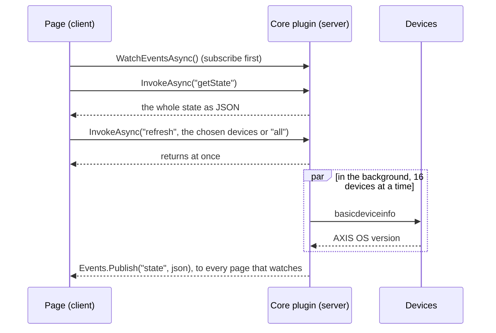

import { Code, FileTree, Aside } from '@astrojs/starlight/components';
import serverProject from '../../../../../samples/Oadm.Samples.FirmwareOverview/Oadm.Samples.FirmwareOverview.csproj?raw';
import models from '../../../../../samples/Oadm.Samples.FirmwareOverview/FirmwareModels.cs?raw';
import plugin from '../../../../../samples/Oadm.Samples.FirmwareOverview/FirmwareOverviewPlugin.cs?raw';
import clientProject from '../../../../../samples/Oadm.Samples.FirmwareOverview.Client/Oadm.Samples.FirmwareOverview.Client.csproj?raw';
import page from '../../../../../samples/Oadm.Samples.FirmwareOverview.Client/FirmwareOverviewPage.cs?raw';
import viewModel from '../../../../../samples/Oadm.Samples.FirmwareOverview.Client/FirmwareOverviewViewModel.cs?raw';
import viewXaml from '../../../../../samples/Oadm.Samples.FirmwareOverview.Client/FirmwareOverviewView.axaml?raw';
import viewCode from '../../../../../samples/Oadm.Samples.FirmwareOverview.Client/FirmwareOverviewView.axaml.cs?raw';
import fakes from '../../../../../samples/Oadm.Samples.FirmwareOverview.Tests/Fakes.cs?raw';
import tests from '../../../../../samples/Oadm.Samples.FirmwareOverview.Tests/FirmwareOverviewTests.cs?raw';
import { template } from '../../../components/templateCode';

A plugin page is an entry in the navigation rail with a page of its own, like the NTP server or Edge storage. Behind it
runs a **core plugin**: a service inside the OADM server that keeps state, talks to the devices and answers the page.

In this tutorial you create **Firmware overview**: a page with the AXIS OS version of the devices the user chooses. The
purple **Choose devices** button picks them (All devices, tags or single devices); the server then reads them, 16 at a
time, and the table fills in as soon as the read is done, on every client that shows the page.

## 1. Create it

You need the [.NET 10 SDK](https://dotnet.microsoft.com/download) and an editor. Run:

```sh
dotnet new install Oadm.Plugin.Templates
dotnet new oadm-page -n MyCoolPage
cd MyCoolPage
dotnet tool restore
dotnet build
```

This creates the tutorial's plugin under your name. It builds, its tests pass, and it runs. The code below is the
original; in your copy every `FirmwareOverview` reads `MyCoolPage` and the id is `community.my-cool-page`.

<FileTree>
- MyCoolPage/
  - MyCoolPage.slnx
  - MyCoolPage/ the server part: the service
    - MyCoolPage.csproj
    - FirmwareModels.cs the rows, the state and the method names both parts share
    - MyCoolPagePlugin.cs the service
  - MyCoolPage.Client/ the client part: the page
    - MyCoolPage.Client.csproj
    - MyCoolPagePage.cs the rail entry
    - MyCoolPageViewModel.cs
    - MyCoolPageView.axaml
    - MyCoolPageView.axaml.cs
  - MyCoolPage.Tests/
    - Fakes.cs the page's context without a network
    - MyCoolPageTests.cs
  - .oadm/plugins/community.my-cool-page/ after a build: the plugin folder OADM loads
</FileTree>

<Aside title="In a checkout of OADM">
`./manage.sh new page --name "My cool page"` creates the same plugin in `plugins/` and `tests/` of the repository and adds
it to the solution; `./manage.sh run dev` then starts OADM with it.
</Aside>

## 2. How a page talks to its service



- The page calls **methods** of the server part by name, with JSON in and out (`InvokeAsync`).
- The server part pushes **events** to every page that shows it (`Events.Publish`). Several users, or several windows
  of one user, all see the same table.
- Events can be lost when the connection drops. So the page always **subscribes, reads the whole state, then applies
  events**, and starts over after a drop. A version number in the state lets the page ignore anything older than what
  it shows.
- Long work never blocks a method: the method starts it and returns; the result arrives as an event.

## 3. The project files

Both projects use the plugin project SDK `Oadm.Plugin.Sdk` (the template writes the version you installed). It compiles
against the OADM SDK but never copies it: OADM provides it at runtime. The server project's properties become the
plugin's `plugin.json`: the `OadmPluginId` is the plugin's key everywhere and never changes, the display name and
description are its row on the **Plugins** page, where administrators turn it on and off.

<Code code={template(serverProject)} lang="xml" title="MyCoolPage.csproj" />

Add `<OadmEnabledByDefault>false</OadmEnabledByDefault>` when the plugin works in the background or is not for
everyone: it then stays off until an administrator turns it on.

The client project names the same plugin id and references the server project to share the models. The SDK adds
Avalonia; the data grid comes without a version, the SDK takes the one of the OADM client.

<Code code={template(clientProject)} lang="xml" title="MyCoolPage.Client.csproj" />

## 4. The contract

The page and the service agree on three things: the method names, the event topic and the JSON of the state. Keeping
them in one file of the server project means a typo cannot break the page.

<Code code={template(models)} lang="csharp" title="FirmwareModels.cs" />

## 5. The service

- **`Id`, `DisplayName`, `IconKey`, `Group`**: the rail entry. `Group` places it under a heading of the rail (here
  Maintenance).
- **`StartAsync`** runs when the server starts and when an administrator turns the plugin on. Keep the context and
  return at once; never wait for devices here.
- **`InvokeAsync`** is the page's backend. Throw `ArgumentException` for bad input and `InvalidOperationException` for
  a wrong state: the page gets the message.
- **`refresh`** checks the request first: the page sends "all" or the chosen ids, never nothing. A server can manage
  30,000 devices, so a page never reads every device by itself.
- **`ReadAsync`** reads the chosen devices with at most 16 at a time and 5 seconds each: never one by one, and never
  all at once.
- **`DeviceMessages.Refusal`** skips devices OADM must not contact: a changed certificate, a rejected password, no
  password yet, or not answering. The row says why, in the same words as the rest of OADM.
- **`ctx.Vapix.CreateAsync`** gives a client that is already logged in to the device. The server keeps it; never
  dispose it.
- **`Publish`** stores the new state with the next version and sends it to every page.
- The sample reads devices through `ctx`, so it serves users with all devices. A user limited to a device group gets
  "Only users with all devices can do this." from it. To serve them too, implement `InvokeAsync(caller, ...)` and read
  through `caller.Devices` and `caller.Vapix`: see [Device groups](../device-groups/).

<Code code={template(plugin)} lang="csharp" title="MyCoolPagePlugin.cs" />

The context offers more: `Settings` (stored JSON of the plugin, e.g. its configuration), `Secrets` (encrypt passwords you
store), `DataDirectory` (a private folder for files), `Tasks` (start tasks on devices, which show in the tasks pane) and
`Logger` (the server log).

## 6. The page

The client loader finds the class that implements `ICorePluginPage` with your plugin id and adds the rail entry.
`CreateView` runs for every view of the page: the rail and each **Open in new window** get their own context and view
model, so keep all state in the view model.

<Code code={template(page)} lang="csharp" title="MyCoolPagePage.cs" />

The view model holds the page's state. `RunAsync` is the subscribe, read, apply loop described above. The rows go into a
`RangeObservableCollection` and are replaced in one step, which keeps the grid fast with thousands of rows.

`PageDeviceChoice` is the device choice of the page: it starts with the Devices page selection, else the last choice on
this computer, else with nothing. While nothing is chosen the page reads nothing and Refresh is off. `ButtonText` is the
text of the purple button ("Choose devices", "Selected devices: Tag Building A"); `Resolve()` gives the devices of the
choice now. All devices goes to the server as "all", not as every id.

<Code code={template(viewModel)} lang="csharp" title="MyCoolPageViewModel.cs" />

The view uses the shared controls: the purple choice button first, a toolbar button, the progress row, a status chip for problems, the error text below
the table. `ui:PageHeader.Subtitle` puts one short sentence next to the page title; the page itself starts with its
content. No colors or sizes of its own, so the page looks right in dark and light.

<Code code={template(viewXaml)} lang="xml" title="MyCoolPageView.axaml" />

The device picker needs the window, so the view hands the view model a way to open it (`PickDevices`).

<Code code={template(viewCode)} lang="csharp" title="MyCoolPageView.axaml.cs" />

<Aside title="Who may do what">
Every page gets the permission "show" by itself. When a method changes something, declare a permission for it
(`Permissions` and `RequiredPermission(method)` in the core plugin) so administrators can give or withhold it per role on
the **Access** page. The server checks every call; the page asks `ctx.Has(...)` to hide what the role lacks.
</Aside>

## 7. The tests

`FakeCoreContext` of the package `Oadm.Sdk.Testing` stands in for the server: a device list, a `FakeCamera` per device,
and a channel that collects the published events. `FakePageContext` connects the page straight to the service, so the
page test runs the whole round trip without a network.

<Code code={template(fakes)} lang="csharp" title="Fakes.cs" />

Test the read of the chosen devices, "all" and a request without devices, the devices that must not be contacted, a bad
method, that the page reads nothing before a choice and that it ignores older states:

<Code code={template(tests)} lang="csharp" title="MyCoolPageTests.cs" />

## 8. Run it

```sh
dotnet test
dotnet oadm dev start
```

`dev start` runs an OADM server for development in this terminal, with its own data in `.oadm/`, and loads your plugin;
a new build restarts it. In a second terminal, `dotnet oadm dev client` opens the client against it: create the
administrator on the first start and add a few cameras. The rail shows **MyCoolPage** under Maintenance. Click **Choose devices** and choose some: the progress row shows while
the server reads, then the table fills in. Open the page in a second window from the rail entry's context menu and refresh again: both update.

## 9. Make it yours

1. **The rail entry**: `DisplayName`, `IconKey`, `Group`.
2. **The state**: the row and state records, and what `ReadAsync` reads per device.
3. **The methods**: one constant per method, one case in `InvokeAsync`, one command in the view model.
4. **The view**: columns, buttons, a card layout of your own (set `HasOwnCards` in the page class).
5. **Settings that stay**: store them with `ctx.Settings.SetAsync("config", json, ct)` and read them in `StartAsync`.
6. **The tests**: one per method and per kind of device answer.

## 10. Share it

`dotnet oadm deploy --installed` puts it into the OADM installed on your computer; `dotnet oadm pack` writes the
`.oadmplugin` file for others. Both are explained in [Develop with the .NET SDK](../plugin-sdk/#try-it-in-the-installed-oadm).
To ship it with OADM, open a pull request on GitHub with the plugin, its tests and a `README.md` in its folder that says
what it does and on which devices you tried it.
