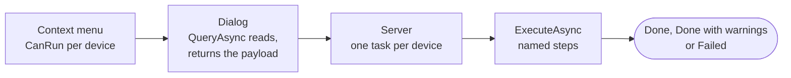

import { Code, FileTree, Aside } from '@astrojs/starlight/components';
import serverProject from '../../../../../samples/Oadm.Samples.UpnpName/Oadm.Samples.UpnpName.csproj?raw';
import shared from '../../../../../samples/Oadm.Samples.UpnpName/UpnpName.cs?raw';
import task from '../../../../../samples/Oadm.Samples.UpnpName/UpnpNameTaskPlugin.cs?raw';
import clientProject from '../../../../../samples/Oadm.Samples.UpnpName.Client/Oadm.Samples.UpnpName.Client.csproj?raw';
import dialog from '../../../../../samples/Oadm.Samples.UpnpName.Client/UpnpNameDialog.cs?raw';
import viewModel from '../../../../../samples/Oadm.Samples.UpnpName.Client/UpnpNameViewModel.cs?raw';
import windowXaml from '../../../../../samples/Oadm.Samples.UpnpName.Client/UpnpNameWindow.axaml?raw';
import windowCode from '../../../../../samples/Oadm.Samples.UpnpName.Client/UpnpNameWindow.axaml.cs?raw';
import tests from '../../../../../samples/Oadm.Samples.UpnpName.Tests/UpnpNameTaskPluginTests.cs?raw';
import { template } from '../../../components/templateCode';

A task plugin is an entry in the device context menu. The user selects devices, picks the entry, fills a dialog, and
OADM runs the work on the server, **one task per device**. Each task shows in the tasks pane with its steps and log,
so one device that fails never marks the others as failed.

In this tutorial you create **Set UPnP name**: it gives devices a new UPnP name (the name Windows shows in its network
list). It has everything a real task needs: a dialog with validation, a read of the current value, a check of the
device's API, named steps, a check after the write, and tests that run without a camera.

## 1. Create it

You need the [.NET 10 SDK](https://dotnet.microsoft.com/download) and an editor. Run:

```sh
dotnet new install Oadm.Plugin.Templates
dotnet new oadm-task -n MyCoolPlugin
cd MyCoolPlugin
dotnet tool restore
dotnet build
```

This creates the tutorial's plugin under your name. It builds, its tests pass, and it runs. The code below is the
original; in your copy every `UpnpName` reads `MyCoolPlugin` and the id is `community.my-cool-plugin` (choose your own
with `--id acme.my-cool-plugin`).

<FileTree>
- MyCoolPlugin/
  - MyCoolPlugin.slnx
  - MyCoolPlugin/ the server part: does the work on the devices
    - MyCoolPlugin.csproj
    - MyCoolPlugin.cs the payload and the rules both parts share
    - MyCoolPluginTaskPlugin.cs the task
  - MyCoolPlugin.Client/ the client part: the dialog
    - MyCoolPlugin.Client.csproj
    - MyCoolPluginDialog.cs
    - MyCoolPluginViewModel.cs
    - MyCoolPluginWindow.axaml
    - MyCoolPluginWindow.axaml.cs
  - MyCoolPlugin.Tests/
    - MyCoolPluginTaskPluginTests.cs
  - .oadm/plugins/community.my-cool-plugin/ after a build: the plugin folder OADM loads
</FileTree>

<Aside title="In a checkout of OADM">
`./manage.sh new task --name "My cool plugin"` creates the same plugin in `plugins/` and `tests/` of the repository and
adds it to the solution; `./manage.sh run dev` then starts OADM with it.
</Aside>

## 2. How a task runs



1. The user selects devices and picks your entry. The entry is greyed out with a reason for devices it cannot run on.
2. Your **dialog** opens on the user's computer. It may read the current state from a device, then returns a
   **payload**: a small JSON text with what the user chose.
3. The **server** creates one task per device and runs your `ExecuteAsync` for each, up to 16 at a time. It hands you
   a VAPIX client that is already logged in to the device; the password never reaches your code.
4. Every request and every wait is a **step** with a name. The user sees the steps live, and which one failed.
5. Returning means **Done**, an exception means **Failed** with its message, a warning means **Done with warnings**.

The server part never shows UI, the client part never talks to a device.

## 3. The project files

Both projects use the plugin project SDK `Oadm.Plugin.Sdk` (the template writes the version you installed). It compiles
against the OADM SDK but never copies it: OADM itself provides it at runtime. The server project's properties become the
plugin's `plugin.json`: the `OadmPluginId` is the plugin's key everywhere (folder, settings, permissions) and never
changes, the display name and description are its row on the **Plugins** page.

<Code code={template(serverProject)} lang="xml" title="MyCoolPlugin.csproj" />

Add `<OadmEnabledByDefault>false</OadmEnabledByDefault>` to keep the plugin off until an administrator turns it on.

The client project names the same plugin id, and references the server project to share its payload record. The SDK
adds the client SDK and Avalonia (the UI framework).

<Code code={template(clientProject)} lang="xml" title="MyCoolPlugin.Client.csproj" />

After each build both parts land in `.oadm/plugins/<id>/`: the plugin folder OADM loads.

## 4. What both parts share

The dialog and the task must agree on the payload and on what a valid name is. Writing that once, in the server
project, keeps them from drifting apart.

<Code code={template(shared)} lang="csharp" title="MyCoolPlugin.cs" />

## 5. The task

This is the heart of the plugin. Read it from top to bottom:

- **`DisplayName`, `Group`, `IconKey`**: the entry in the context menu, here **Network > Set UPnP name**.
- **`CanRun`** decides from what OADM already knows (status, the device's API list) whether the entry is enabled. It
  must be fast: it runs for every selected device while the menu opens. **`NotSupportedReason`** is the tooltip of a
  greyed entry.
- **`GetTaskName`** is the name in the tasks pane: what this task does ("Set UPnP name Entrance"), never a password.
- **`ExecuteAsync`** runs once per device:
  1. it checks the input before anything is sent;
  2. `PlanSteps` shows all steps as pending;
  3. each `StepAsync` / `BeginStep` is one named step; a step that does not apply is skipped with a reason;
  4. before the first write it asks the device for its API list again and stops with "Nothing was changed" when the
     API is missing;
  5. it reads the value back after writing and warns when the device did not take it.
- **`QueryAsync(ctx, caller, device, ...)`** answers the dialog. It only reads; changing a device here is not allowed.
  OADM checks that the user sees `device` and logs `ctx.Vapix` in to it. A user may be limited to a
  [device group](../device-groups/): a query that reads another device goes through `caller.Devices` and
  `caller.Vapix`. The overload without `caller` stays only because the interface needs it.
- The task itself touches only its own device, through `ctx.Vapix`.

<Code code={template(task)} lang="csharp" title="MyCoolPluginTaskPlugin.cs" />

<Aside type="caution" title="Rules for every plugin that changes devices">
Check the API before the first write. Validate every input before you touch the device. Never remove or demote the
account OADM logs in with (`device.CredentialUserName`). Write a setting that could cut the connection last. Never log
or store a password: the payload stays in memory.
</Aside>

## 6. The dialog

The client loader finds the class that implements `ITaskPluginDialog` with your plugin id. `ShowAsync` opens the
window, prefills it through your query (the dialog works without it too) and returns the payload, or null when the user
cancels.

<Code code={template(dialog)} lang="csharp" title="MyCoolPluginDialog.cs" />

The view model holds the form. It derives from `ValidatingViewModel`: each rule returns an error text or null, the
error shows directly below the field once the user typed or left it, and OK stays disabled while there is one.

<Code code={template(viewModel)} lang="csharp" title="MyCoolPluginViewModel.cs" />

The window uses the shared parts of every OADM dialog: the title bar with its X, a form field with the label left and
the error below the input, and the footer with Cancel and one accent button. Use them and your dialog looks like the
rest of the app in dark and light, without any colors or sizes of its own.

<Code code={template(windowXaml)} lang="xml" title="MyCoolPluginWindow.axaml" />

<Code code={template(windowCode)} lang="csharp" title="MyCoolPluginWindow.axaml.cs" />

## 7. The tests

The tests need no camera. The package `Oadm.Sdk.Testing` has what they use: `FakeCamera` answers parameter reads and
writes and the API list, `FakeDevice` is the device as OADM knows it, `FakeTaskContext` records the steps, and `StepRun`
ends the task the way the server does (it adds the final step **Completed** on success).

Test the normal run step by step, a value that is already set, a device without the API, invalid input, what the
menu shows and the dialog's query. `FakeCoreContext` runs the query like OADM, as `CallAsGroup([ids])` or
`CallAsAllDevices()`. The **canary** (`PluginCanary` with `TaskPluginCanaryHost`) starts the task as a user whose group
holds one device and checks that a device outside the group is refused like an unknown one
([Device groups](../device-groups/#test-it-the-canary)):

<Code code={template(tests)} lang="csharp" title="MyCoolPluginTaskPluginTests.cs" />

## 8. Run it

```sh
dotnet test
dotnet oadm dev start
```

`dev start` runs an OADM server for development in this terminal, with its own data in `.oadm/`, and loads your plugin;
a new build restarts it. In a second terminal, `dotnet oadm dev client` opens the client against it: create the
administrator on the first start and add a camera. Select it, right-click, and open **Network > MyCoolPlugin**. The tasks
pane shows one task per device; **Details** shows its steps and log.

## 9. Make it yours

Change one thing at a time and keep the tests green:

1. **Name and place**: `DisplayName` (at most 32 characters, no "..."), `Group`, `IconKey`.
2. **Which devices**: `CanRun` and `NotSupportedReason`. Check the API your task uses with
   `device.Apis.Supports("api-id", "1.0")`.
3. **What the user chooses**: the payload record, the dialog's fields and their rules.
4. **What happens on the device**: the steps in `ExecuteAsync`, one named step per request. Name steps as short
   commands with the article: "Read the users", "Wait for the device to come back".
5. **The task name**: `GetTaskName` says exactly what one task does.
6. **The tests**: one per path through `ExecuteAsync`.

## 10. Share it

`dotnet oadm deploy --installed` puts it into the OADM installed on your computer; `dotnet oadm pack` writes the
`.oadmplugin` file for others. Both are explained in [Develop with the .NET SDK](../plugin-sdk/#try-it-in-the-installed-oadm).
To ship it with OADM, open a pull request on GitHub with the plugin, its tests and a `README.md` in its folder that says
what it does and on which device and AXIS OS you tried it.
