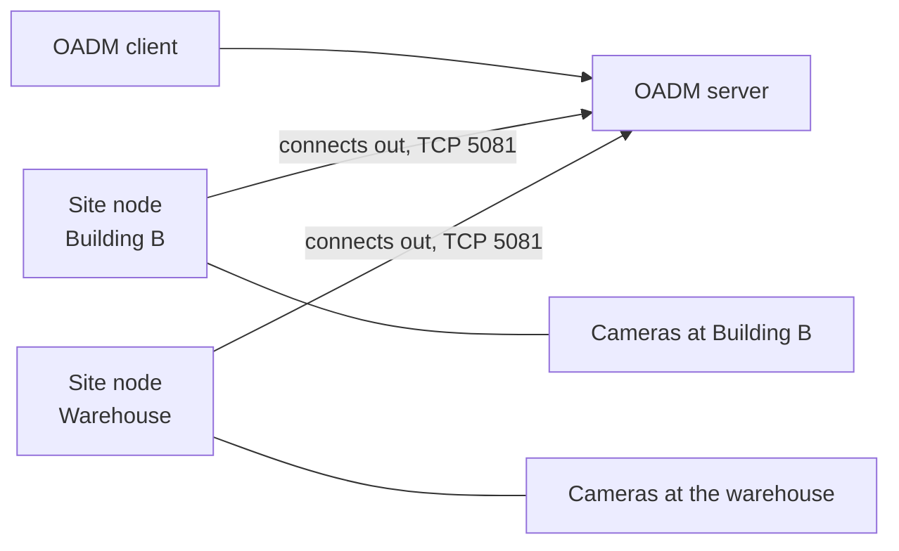

import { LinkCard, CardGrid } from '@astrojs/starlight/components';

A **site** is a network the OADM server cannot reach itself: another building, a network behind a router, a camera
network of its own. Install the **OADM Site Node** on one computer in that network. The server then reaches the devices
there through the node, and you work with them like with every other device.

- **The node connects out to the server.** It never listens: nothing at the site needs an open port. The server
  accepts nodes on TCP 5081 while **Accept site nodes** is on.
- **The node keeps no passwords and no device data.** Only the server does.
- **One site has one node.** A Raspberry Pi 4 or 5 works well as a node; Windows (x64) and Linux (x64, ARM64) are supported.
- **A node works with one server.** It is bound with a pairing code from its app.

Devices at a site show the site in the **Site** column of the device list. Discovery, Network range, Add manually and the
imports also search through every site. When a node is offline, its devices show **Site offline** and nothing is sent
to them until it is back.

<CardGrid>
	<LinkCard title="Set up a site" description="Install the node, connect it to the server and bind it." href="../setup/" />
	<LinkCard title="Sites page" description="Accept site nodes, bind, rename, replace and remove sites." href="../sites-page/" />
	<LinkCard title="OADM Site Node app" description="The node's link, pairing code, networks, ports and command line." href="../node-app/" />
</CardGrid>

## Good to know

- **Trust the site node like a device**: OADM tries the passwords of the credential list on devices it finds at a site,
  after the same Axis check as on its own network. A device that imitates an Axis device, or a site node someone took
  over, could see those passwords. Bind only nodes on computers you control, and keep the credential list short.
- **Encryption**: the link between node and server is encrypted. Devices reached over HTTPS stay encrypted all the way;
  devices on plain HTTP or plain RTSP can be read on the node's computer, like on the network itself.
- **Plugins at sites**: the **Plugins** page shows which plugins work at sites. The
  [NTP server](../../tools/ntp-server/#devices-at-sites) serves the devices at the sites you choose; the DHCP server
  works only on the server's own network. Web View opens the devices at a site.
