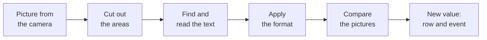

import { Steps, Aside, LinkCard, CardGrid } from '@astrojs/starlight/components';
import { Image } from 'astro:assets';
import page from '../../../assets/screens/text-recognition-page.png';

Text recognition reads text in your cameras' pictures: container and wagon numbers, meters, signs, labels. Each read is
an event for the [event rules](../event-rules/). The server does the reading, nothing changes on the camera and pictures
are never stored.

<Image src={page} alt="The Text recognition page: the readers, the live video with areas, the last reads and the reader's settings" class="screen" />

| Where | What |
|---|---|
| Left | **Readers**: **New**, **Delete**, search, and each reader's mode and last text |
| Middle | The live video with the areas, the last 20 reads below it |
| Right | The reader's settings, its **Areas** and **Save** |
| Top right | Whether the server keeps up, **Load**, what reads the pictures, **Use GPU** |

<Aside type="tip">
For license plates use AXIS License Plate Verifier on the camera. It reads plates better than a general text reader.
</Aside>

## Install

Text recognition is an optional plugin: it is not in the OADM installers.

<Steps>

1. On the [Plugins page](../../admin/plugins/#optional-plugins), under **Optional plugins**, click **Download ZIP**.
2. Click **Install** and choose the ZIP. The server checks the checksum and refuses any other file.
3. Turn on **Text recognition** in the list above. It opens under **Vision** in the navigation rail.

</Steps>

After an OADM update, install it again: the row says **Not loaded. Install it again for this OADM version.** Readers and
settings stay.

## Quick start

Read a container number in 2 minutes.

<Steps>

1. Open **Text recognition**, click **New** and choose the camera.
2. Enter a **Name**. Leave **Mode** on **Watching**.
3. Under **Areas** click **New** and drag a rectangle around the text on the video.
4. In the area's row enter the format `@@@U ###### #`. Leave the field empty to read any text.
5. Check the reads in the table below the video, then click **Save**.
6. In [Event rules](../event-rules/) create a rule with the event **Text read** of this reader.

</Steps>

## What happens to one picture

| Step | What happens | You set |
|---|---|---|
| Picture | **Watching**: a stream at your frames per second. **On action**: one picture | **Mode**, **Stream** |
| Areas | Only the inside of your areas counts. An area that did not change keeps its last result | **Areas** |
| Read | Lines are found and read, at most 30 per picture. Text under about 10 pixels high is left out | Area size, **Resolution** |
| Format | The value that fits is kept and look-alike characters are fixed | [Format](formats/) |
| Compare | A watching reader counts a value once it holds over 2 pictures in a row | [Moving objects](tuning/#belts-and-passing-vehicles) |
| New value | A row in the last 20 reads and the event **Text read** | [Event rules](events/) |

## Learn more

<CardGrid>
	<LinkCard title="Readers and areas" description="Modes, stream settings, where to draw areas, camera angle." href="readers/" />
	<LinkCard title="Formats" description="Tell a reader the shape of the text." href="formats/" />
	<LinkCard title="Events and rules" description="Text read, Read text, examples, dashboards." href="events/" />
	<LinkCard title="Check and tune" description="The last 20 reads, Pause, Moving objects." href="tuning/" />
	<LinkCard title="Speed and limits" description="Graphics card, limits, server size." href="speed/" />
	<LinkCard title="Troubleshooting" description="Permissions and what each message means." href="troubleshooting/" />
</CardGrid>
