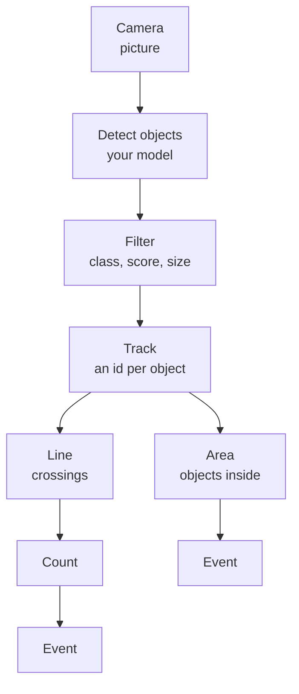

import { Steps, Aside, LinkCard, CardGrid } from '@astrojs/starlight/components';
import { Image } from 'astro:assets';
import page from '../../../../assets/screens/vision-center-page.png';

Vision Center runs your own detection and classification models on your cameras' pictures. You build what you need from
nodes on a canvas: objects in an area, objects that cross a line, counts, times and conditions. At the end an Event node
sends an event to the [event rules](../event-rules/).

<Image src={page} alt="The Vision Center page: the pipelines and models on the left, a pipeline of nodes on the canvas, the live video and the selected node's live output on the right" class="screen" />

## What it needs

| You need | Why |
|---|---|
| A model you upload | OADM ships no model. See [Models](models/) for models that work, with their links |
| A camera OADM manages | Each pipeline works on one camera's video |
| **Watching** or **On action** | **Watching** runs on the stream all the time. **On action** runs one picture when a rule runs **Run pipeline** |

## Install

Vision Center is an optional plugin: it is not in the OADM installers.

<Steps>

1. On the [Plugins page](../../admin/plugins/#optional-plugins), under **Optional plugins**, click **Download ZIP** in the
   row of Vision Center.
2. Click **Install** and choose the ZIP.
3. Turn on **Vision Center** in the list above. It opens under **Vision** in the navigation rail.

</Steps>

After an OADM update it keeps running. See [Updates and backups](../../admin/plugins/#updates-and-backups).

## Quick start

Count the people who pass a door, per day.

<Steps>

1. Download a model, for example
   [rf-detr-medium.onnx](https://huggingface.co/PierreMarieCurie/rf-detr-onnx/resolve/main/rf-detr-medium.onnx) (121 MB).
   In the **Models** card click **Import model**, choose the file and click **Next** until **Import**.
2. Click **New** in **Pipelines** and choose the camera. Enter a name and leave **Mode** on **Watching**.
3. Click **Add node** and add **Detect objects**. Choose the model and, under **Classes**, `person`. Then add **Track**
   and **Line** below it with the **+** under each node. Drag the line across the door on the video.
4. Add **Count** below the line and **Event** below the count. Click the count, then the **+** left of its **Reset** and choose
   **Timer**. Its **Every** is **Day** at `00:00`.
5. Watch the In and Out numbers on the video and in **Live output**, then click **Save**.

</Steps>

The event (the Event node's name, under **Vision Center** > pipeline name) now fires when the count changes. See
[Events and rules](events/).

## What happens to one picture

A pipeline starts at its camera and branches as often as you like. Nodes never form a loop and two branches never join
again.

## What it never does

- **Changes nothing on the camera.** It only receives pictures.
- **Stores no picture.** Pictures stay in the server's memory while a pipeline works on them. Events carry numbers and
  classes, never pictures.
- **Keeps no history.** Counts live in memory and start at 0 after a server restart. Rules and
  [dashboards](../dashboards/) get them as events.
- **Ships no model.** You upload your models. OADM ships no face, person identity or license plate model.

<Aside type="caution">
You choose what your models detect. You are responsible for the models you run, their licences and the privacy law at
your site.
</Aside>

## Learn more

<CardGrid>
	<LinkCard title="Models" description="Models that work, with links, licences and the import." href="models/" />
	<LinkCard title="Export your own model" description="Export to ONNX and the settings of Import model." href="export/" />
	<LinkCard title="Pipelines and the canvas" description="Build a pipeline, draw on the live video, Copy to cameras." href="pipelines/" />
	<LinkCard title="Objects and geometry" description="Detect, classify, filter, track, areas and lines." href="objects/" />
	<LinkCard title="Logic, time and output" description="Conditions, timers, counts, events, control inputs." href="logic/" />
	<LinkCard title="Events and rules" description="What each Event node sends, the actions, examples." href="events/" />
	<LinkCard title="Check and tune" description="Live output, Pause, scores, sizes, frame rates." href="tuning/" />
	<LinkCard title="Examples" description="Whole pipelines with their rules." href="examples/" />
	<LinkCard title="Speed and limits" description="CPU, graphics card, frame rates, limits." href="speed/" />
	<LinkCard title="Troubleshooting" description="Permissions and what each message means." href="troubleshooting/" />
</CardGrid>
